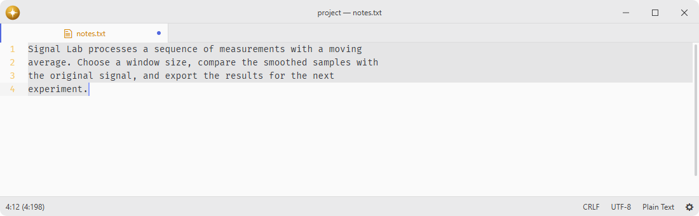

# autoflow

Reflow the current selection so that no line is longer than the preferred line length.

Fork of [pulsar-edit/pulsar](https://github.com/pulsar-edit/pulsar) (`packages/autoflow`).

## Features

- **Selection reflow**: rewraps the selected text to fit within the target line width.
- **Paragraph reflow**: reflows the current paragraph when nothing is selected.
- **Configurable width**: uses the `editor.preferredLineLength` config value when set, defaulting to 80 characters.

## Installation

To install `autoflow` search for it in the Install pane of the Lumine settings, or run the command `lumine --install lumine-code/autoflow`.

## Commands

Commands available in `lumine-text-editor:not([mini]):not([readonly])`:

- `autoflow:reflow-selection`: reflow the selection or current paragraph to the preferred line length.

## Large selections

Large selections and pathological long lines are reflowed from immutable source chunks. Preparation yields cooperatively and publishes one exact edit only while the document and selections remain current. Words are indivisible, so a word longer than the preferred width remains intact even when it exceeds the runtime string limit. Comment prefixes, LaTeX boundary tags, whitespace and CRLF normalization keep the ordinary reflow semantics without constructing a complete paragraph string or a generated regex from an arbitrarily long indentation prefix.

## Contributing

Got ideas to make this package better, found a bug, or want to help add new features? Just drop your thoughts on GitHub. Any feedback is welcome!
